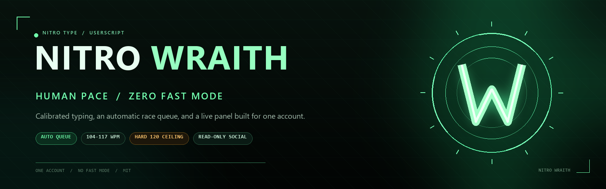

<div align="center">
  
</div>

<h1 align="center">NITRO WRAITH</h1>

<p align="center">
  <strong>Nitro Type, a tu ritmo.</strong><br>
  Un userscript de Tampermonkey que encadena carreras, escribe a un ritmo basado
  en tus propias estadísticas y se detiene cuando hace falta una persona.
</p>

<p align="center">
  <a href="https://gist.githubusercontent.com/ezurinho/88f8b25546f8bb0ea588291bab8ffa58/raw/nitro-wraith.user.js">Instalar</a> ·
  <a href="README.md">English README</a> ·
  <a href="docs/TROUBLESHOOTING.md">Problemas</a> ·
  <a href="CHANGELOG.md">Cambios</a>
</p>

> Una cuenta. Sin contraseñas, sin CAPTCHAs, sin escrituras sociales.

NITRO WRAITH abre la siguiente carrera, escribe dentro de un rango construido
con las estadísticas de tu cuenta y muestra por qué está esperando.

La versión vigente, las notas de release y todos los detalles técnicos están en
el [README en inglés](README.md). Esta guía es un resumen en español.

## Qué hace

| Área | Comportamiento |
| --- | --- |
| **Carreras** | Abre la siguiente carrera tras un retardo humano. Después de una DQ vuelve al garaje en vez de pulsar Try Again. |
| **Tecleo** | Calibra el sobre con la media y el top de la cuenta, con techo duro de 120 WPM. El objetivo vivo empieza en la media y se corrige tras cada carrera: sube tras tres limpias y baja si falla el ritmo o la precisión. Una DQ también lo baja, salvo que venga de un freeze registrado: eso es un fallo de tiempo, no de cadencia. El freno aprendido se conserva entre recargas. Una racha lenta no fija el objetivo. La precisión se mantiene en 96% o más. |
| **Recompensas** | Reclama la Mystery Box, cierra los retos diarios y envía un sticker por carrera si está activado. |
| **Sesión** | Renueva la sesión cuando hace falta. Las contraseñas y los CAPTCHAs siguen siendo manuales. |
| **Límites** | Carreras, tiempo, XP, horas activas y presupuestos diarios. |
| **Social** | Contadores de Friends y Team en modo solo lectura. |

## El panel

- **Live:** WPM, precisión, ritmo y precisión recientes de los últimos seis
  segundos, objetivo, media de la tanda, resultado y HUD del juego. Si la
  carrera deja de aceptar teclas, el indicador se pone ámbar (`stalled 3s`) y
  las cifras recientes se ocultan en vez de fingir que están vivas.
- **Garage:** qué espera la cola, la siguiente carrera, la Mystery Box, la
  última parada y el resumen de siete días. Incluye el control **AFK off/on**.
- **Tune:** perfil de ritmo, límites, descansos, stickers, sonido, alertas,
  farming AFK (apagado por defecto), keep-alive, interlock y centro de salud.
- **Log / Info:** historial, temporada, diagnóstico y mapa de teclado.

El panel tiene **modo seguro**: si un error interno se repite o ocurre mientras
se teclea, suelta el bloqueo, para la cola y muestra un aviso con **resume** y
**copy report**. También detecta **cambios en la UI del juego** (`ui-drift`) y se
detiene en vez de pulsar a ciegas.

## Instalar

1. Instala [Tampermonkey](https://www.tampermonkey.net/).
2. Abre el [enlace de instalación](https://gist.githubusercontent.com/ezurinho/88f8b25546f8bb0ea588291bab8ffa58/raw/nitro-wraith.user.js) y confirma.
3. Entra en [nitrotype.com](https://www.nitrotype.com/).
4. Recarga la página. El panel aparece en la esquina inferior.

Para probar el siguiente build antes de que sea estable, instala el
[userscript canary](https://github.com/ezurinho/nitro-wraith/releases/download/canary/nitro-wraith.user.js).
En un build canary, el botón **stable** de TUNE vuelve al canal normal.

> **Importante:** usa una sola copia del userscript. NITRO WRAITH sustituye a
> los viejos "Auto Redirect Script" y "Auto Stickers"; otra copia pelea por la
> cola y por el bloqueo de tecleo.

## Controles

| Atajo | Acción |
| --- | --- |
| <kbd>Alt</kbd> + <kbd>A</kbd> | Reanudar, incluso a mitad de carrera |
| <kbd>Alt</kbd> + <kbd>N</kbd> | Parar |
| <kbd>Esc</kbd> / <kbd>Alt</kbd> + <kbd>S</kbd> | Parar después de la carrera actual |
| <kbd>Alt</kbd> + <kbd>T</kbd> | Cambiar el tema del panel |
| <kbd>Alt</kbd> + <kbd>G</kbd> | Plegar el panel del garaje |
| <kbd>Alt</kbd> + <kbd>M</kbd> | Mini-HUD: completo, compacto u oculto |
| <kbd>Alt</kbd> + <kbd>R</kbd> | Vaciar el historial del panel |
| <kbd>Alt</kbd> + <kbd>H</kbd> | Imprimir las tandas cerradas en la consola |

## Seguridad

> **Aviso:** Nitro Type no permite bots y su anti-cheat puede banear una cuenta.
> NITRO WRAITH intenta mantener las estadísticas creíbles, pero no puede hacer
> invisible la automatización. Úsalo en tu propia cuenta y bajo tu riesgo.

El script nunca escribe credenciales y nunca intenta resolver un CAPTCHA. Si el
sitio reporta un baneo permanente, se detiene y no vuelve a intentar la cuenta.
Cuando el navegador no tiene red, la cola espera y se recupera sola al volver
`online`. Chrome puede congelar una pestaña oculta: mantén la pestaña de carrera
visible para sesiones largas; el farming AFK está apagado por defecto. Si un
freeze coincide con una carrera, el farming oculto queda en espera hasta que una
carrera arranque con la pestaña visible; una carrera visible o el reset de salud
AFK lo desbloquea.

**Privacidad:** no hay telemetría, analítica ni logging de terceros. El
`player_token` se lee solo para llamar a la API del propio Nitro Type. La única
petición fuera del sitio es la comprobación pública de versión en el Gist y, si
falla, el meta público de la última release de GitHub; el canary usa el meta del
pre-release canary. Todas son sin credenciales. Antes de ofrecer una
actualización, el panel compara el SHA-256 del userscript con el `build.json` de
la release: si no coincide, no abre la instalación y lo muestra como
`integrity: ...`.

## Releases y canary

Las releases estables son automáticas: cuando `check` pasa en `main` y el
userscript cambió, el workflow sube la versión, actualiza el changelog y el
README, sincroniza el Gist, crea el tag y publica la release.

Cada nueva release estable publica también `build.json` y `SHA256SUMS`. Para
comprobar una release:

```bash
npm run release:verify -- vX.Y.Z
```

Funciona con una release que incluya `build.json` y `SHA256SUMS` (la próxima
estable y posteriores); los tags viejos no los tienen. El panel usa el mismo
manifiesto antes de ofrecer una actualización, así que un Gist alterado o una
CDN con contenido viejo no se instalan. El canal **canary** es independiente: publica un pre-release con URLs fijas y
nunca toca el Gist estable, los tags estables ni `releases/latest`. Para volver
atrás, ejecuta el workflow **canary** con `ref` apuntando a un tag
`canary-<versión>` anterior. El runbook completo, incluida la recuperación de
una release estable mala, está en [docs/ROLLBACK.md](docs/ROLLBACK.md).

## Navegadores

Chrome y Edge (Chromium) son los navegadores probados. Firefox no está probado;
los reports son bienvenidos, pero Web Locks, Page Lifecycle y el audio pueden
comportarse distinto. Ver [docs/COMPATIBILITY.md](docs/COMPATIBILITY.md).

## Desarrollo

El userscript no tiene dependencias en runtime. El harness necesita Node 22+ y
Chrome.

```bash
npm run build       # concatena src/ en nitro-wraith.user.js y .meta.js
npm run live:test   # checks de CLI sin abrir Chrome
npm run check       # build sincronizado, sintaxis, release/README y harness
npm test            # harness de navegador
npm run visual      # 15 capturas del panel contra las baselines
npm run budget      # tamaño del artefacto, gzip y límites por fragmento
npm run score       # nota de higiene estática (duplicados, patrones de riesgo, tests, docs)
npm run build:repro # build limpio en dos entornos, comparado por SHA-256
```

El código fuente vive en [`src/`](src/README.md): 20 fragmentos ordenados dentro
de un solo IIFE. `nitro-wraith.user.js` es el único archivo instalable y no se
edita a mano; edita `src/`, ejecuta `npm run build` y verifica con
`npm run check`.

## Documentación

- [`README.md`](README.md): guía completa en inglés.
- [`docs/NITROTYPE.md`](docs/NITROTYPE.md): notas del juego y límites de diseño.
- [`docs/TROUBLESHOOTING.md`](docs/TROUBLESHOOTING.md): problemas frecuentes.
- [`docs/ROLLBACK.md`](docs/ROLLBACK.md): rollback y hotfix.
- [`docs/COMPATIBILITY.md`](docs/COMPATIBILITY.md): navegadores.
- [`docs/ARCHITECTURE.md`](docs/ARCHITECTURE.md): módulos, bucle de carrera y confianza del update.
- [`docs/adr/`](docs/adr/): decisiones y sus consecuencias.
- [`SECURITY.md`](SECURITY.md): reporte privado de vulnerabilidades.
- [`CHANGELOG.md`](CHANGELOG.md): cambios por versión.

## Licencia

MIT. Ver [LICENSE](LICENSE).

<p align="center"><sub>NITRO WRAITH · una cuenta · tu ritmo</sub></p>
