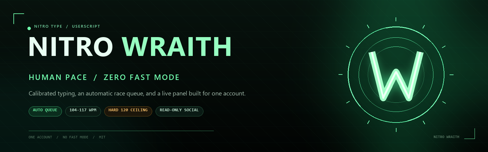
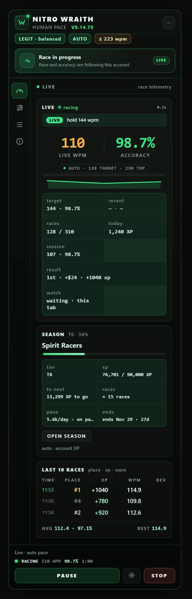
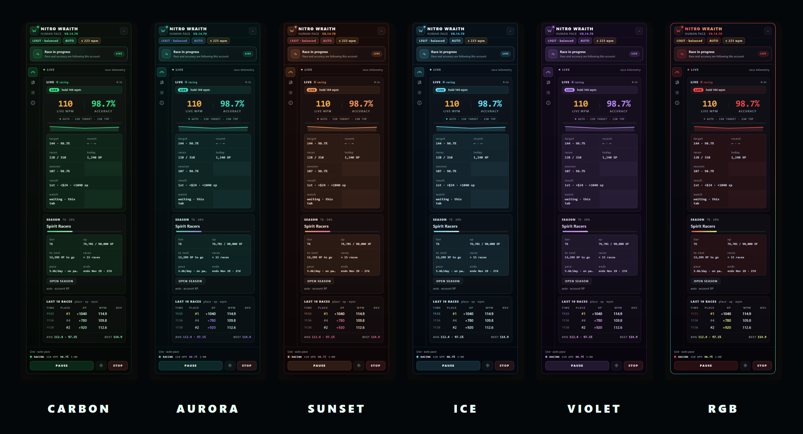

<div align="center">
  
</div>

<p align="center">
  
</p>

<h1 align="center">NITRO WRAITH</h1>

<p align="center">
  <strong>Nitro Type, at your pace.</strong><br>
  A Tampermonkey userscript that queues races, types at a pace based on your own
  stats, and pauses when something needs a human.
</p>

<p align="center">
  <a href="https://gist.githubusercontent.com/ezurinho/88f8b25546f8bb0ea588291bab8ffa58/raw/nitro-wraith.user.js"></a>
  <a href="https://github.com/ezurinho/nitro-wraith/releases/latest"></a>
  <a href="https://github.com/ezurinho/nitro-wraith/actions/workflows/check.yml"></a>
  <a href="LICENSE"></a>
  <a href="CHANGELOG.md"></a>
</p>

<p align="center">
  <a href="#install">Install</a> ·
  <a href="#controls">Controls</a> ·
  <a href="#safety">Safety</a> ·
  <a href="#development">Development</a> ·
  <a href="CHANGELOG.md">Changelog</a>
</p>

> One account. No passwords, no CAPTCHAs, no social writes.

NITRO WRAITH opens the next race, types inside a range built from your account
stats, and shows why it is waiting.

<!-- release:start -->
## Current release

**[8.14.48](https://github.com/ezurinho/nitro-wraith/releases/tag/v8.14.48)** · 2026-11-18

- feat: add a GitHub fallback for update checks

[Full changelog](CHANGELOG.md)
<!-- release:end -->

## What it does

| Area | Behaviour |
| --- | --- |
| **Race loop** | Opens the next race after a short human delay. After a DQ it returns to the garage instead of pressing Try Again. |
| **Typing** | Builds a WPM range from the account that is signed in, capped at 120. A slow streak cannot lower the target, and a high top can recover it by at most 25% above the real average. The panel shows `avg · target · top` together. Accuracy stays at 96% or above. |
| **Rewards** | Claims the Mystery Box, closes daily challenges and sends one sticker in every race when stickers are on. |
| **Session care** | Renews the session when needed. Passwords and CAPTCHAs stay manual. |
| **Limits** | Session races, time, XP, active hours and daily race/XP budgets. |
| **Social** | Read-only Friends and Team counters. |

## The panel

<p align="center">
  
</p>

<p align="center"><sub>A harness capture with demo values. The real panel sits in the bottom-right corner of the game.</sub></p>

- **Live:** WPM, accuracy, the AUTO pace badge, target range, race count, session average, result and the game HUD. The **Account** card shows the signed-in account, effective average, target, top, monthly rows/pages, last read and a one-click refresh.
- **Garage queue:** what the bot is waiting for, the next race, Mystery Box timing, the last stop and a seven-day mix of DQ, limit, manual and ban stops. The same panel has the **AFK off/on** control, the keep-alive state and whether the queue is visible, hidden or blocked by another gate.
- **Tune:** pace profile, limits, breaks, stickers, sound, desktop alerts, AFK farming (off by default), the optional AFK keep-alive, the **AFK interlock**, the **AFK safety guard**, a live **AFK health** row and a **Health center** that summarizes account, AFK, update and freeze state. The filter at the top narrows the cards by setting name, description or section and clears back to all with one click.
- **Log / Info:** history, season snapshot, diagnostics and the keyboard map.

The update badge only appears when the Gist has a newer version. The script
checks every 5 minutes and again whenever you return to the tab, so a new
release shows up without waiting an hour. If you do not see it, your copy is
current. **versions** in TUNE opens the GitHub release history, so a release
that misbehaves can be replaced with an earlier one; the diagnostic report now
includes the recent flight recorder (sanitized events across reloads).

## Pace

The first load reads your average, top WPM and full monthly history from the
account that is signed in. The stats API refreshes them every 30 minutes, and
another read is triggered automatically every 25 completed races so a long
session follows the account without waiting for the clock. Clicking `auto` or
the **refresh** button on the Live Account card forces a fresh read, and a new
script version triggers one immediately after the update. A transient monthly
page failure is retried once before the last complete snapshot is used.
Calibration is tied to the account ID: if you switch accounts in the same
browser, the old range is cleared and the new account is read before racing.
If a read fails, the card shows the retry and the bot tries again after two
minutes, then after fifteen minutes while the API stays down; coming back
online or returning to the tab also asks again.

Automatic calibration has two rules:

- **It only goes up.** A lower average cannot replace a higher target that is
  already saved. Only the custom override can bring it down.
- **The top sets a proportional recovery floor.** If your top is at least 80
  WPM and at least 1.8× your average, the target becomes
  `min(110, round(top × 0.48), round(average × 1.25))`. A 38 WPM average with a
  230 top recovers to 48 WPM (range 41–55); a 50 WPM account reaches 63, not
  110. A 100 WPM account can still reach the 110 cap. A beginner with a 50 top
  stays where they are.

When the API exposes monthly totals, the target also anchors to the higher
lifetime average. The report shows how many rows and pages were used; if a page
fails, the last complete snapshot is kept. The account row shows the short
average, the effective target and the top together, for example
`38.0 avg · 48 target · 230 top`; the target is the middle of the range being
  typed, never the top and never a fixed 110.

`TUNE` has optional **custom WPM** (15–119) and **custom accuracy** (96–100)
fields. Leave them empty or at 0 for automatic calibration. The values are saved
with the rest of the configuration and included in exports. **AFK farming** is
off by default: with it off, no new race starts while the tab is hidden, which
removes the hidden-tab freeze DQ risk. It can be switched from `TUNE` or from
the garage's **AFK off/on** button; the change reaches the race frame, the
garage queue and other tabs at once, without a reload. With no other gate
active, the `afk` row reads `off`, `on` or `on · hidden`; a sign-in, stop,
block or active-hours gate still takes priority. Turn it on only if you accept
that risk.

The optional **AFK keep-alive** is still off by default. When AFK farming is on,
it plays a near-silent constant signal through a local `AudioContext` so Chrome
has a reason to treat the tab as active instead of freezing it. No file is
downloaded and nothing is audible; the switch shows `on`, `ready`, `blocked`,
`waiting` or `n/a` so a suspended context is not advertised as protection. A
first click is required because browsers only allow audio after a gesture, and
muting the tab or the system can still disable it. This is best effort, not a
guarantee: keep the tab visible for long runs if the race cannot be lost.

**AFK interlock** is opt-in: with it on, a hidden tab cannot open a race until
the keep-alive reports a running context. **AFK safety guard** is on by default:
if a disqualification arrives within 15 minutes of a recorded freeze while AFK
is on, AFK is turned off and the reason is kept in the panel and the diagnostic
report. It cannot undo the disqualification. **Desktop alerts** are opt-in and
ask for browser permission on the first click; they are used only for DQ, site
blocks and the AFK guard.

## Themes

<p align="center">
  
</p>

<p align="center"><sub><strong>Carbon</strong>, <strong>Aurora</strong>, <strong>Sunset</strong>, <strong>Ice</strong>, <strong>Violet</strong> and <strong>RGB</strong>. Press <kbd>Alt</kbd> + <kbd>T</kbd> to switch.</sub></p>

## Install

1. Install [Tampermonkey](https://www.tampermonkey.net/).
2. Open the [install link](https://gist.githubusercontent.com/ezurinho/88f8b25546f8bb0ea588291bab8ffa58/raw/nitro-wraith.user.js) and confirm.
3. Sign in at [nitrotype.com](https://www.nitrotype.com/).
4. Reload the page. The panel appears in the bottom-right corner.

> [!IMPORTANT]
> Use one userscript only. NITRO WRAITH replaces the old "Auto Redirect Script"
> and "Auto Stickers"; another copy will fight over the queue.

Manual install: create a new Tampermonkey script and paste
[`nitro-wraith.user.js`](nitro-wraith.user.js).

## Controls

| Shortcut | Action |
| --- | --- |
| <kbd>Alt</kbd> + <kbd>A</kbd> | Resume, including mid-race |
| <kbd>Alt</kbd> + <kbd>N</kbd> | Stop |
| <kbd>Esc</kbd> / <kbd>Alt</kbd> + <kbd>S</kbd> | Stop after the current race |
| <kbd>Alt</kbd> + <kbd>T</kbd> | Cycle the panel theme |
| <kbd>Alt</kbd> + <kbd>G</kbd> | Fold the garage panel |
| <kbd>Alt</kbd> + <kbd>M</kbd> | Mini-HUD: full, compact or hidden |
| <kbd>Alt</kbd> + <kbd>R</kbd> | Clear the panel history |
| <kbd>Alt</kbd> + <kbd>H</kbd> | Print closed sessions to the console |

In the garage, **Resume** does the same as <kbd>Alt</kbd> + <kbd>A</kbd>.

## Safety

> [!WARNING]
> Nitro Type does not allow bots, and its anti-cheat can ban an account. NITRO
> WRAITH tries to keep the stats believable, but it cannot make automation
> invisible. Use your own account, at your own risk.

The script never types credentials and never attempts a CAPTCHA. If the site
reports a permanent ban, it stops and does not try the account again. When the
browser reports no network, the garage stops pressing "Race Now"/"Continue" and
shows `waiting · offline`; the queue resumes by itself on the `online` event. Chrome can
freeze a hidden tab, so keep the race tab visible for long unattended runs; AFK
farming is off by default for the same reason. Its garage button makes the
choice explicit, and the row tells you whether the hidden mode is actually on.
The optional AFK keep-alive can reduce the freeze risk with near-silent local
audio, but it is disabled by default and cannot guarantee that a browser,
Energy Saver or a muted tab will keep running. The race loop also recovers a Web
Lock left by a frozen tab and sends a watchdog key if a live race goes too long
without an accepted character.

**Privacy:** there is no telemetry, analytics or third-party logging. The
`player_token` is read only to call Nitro Type's own same-origin API. It is never
printed, exported or sent to another host. The only off-site request is the
public Gist version check and, if it is unavailable, the public meta asset of the latest GitHub release; both are made without credentials.

## Releases

Releases are automatic. When `check` passes on `main` and the userscript changed,
the workflow bumps the version, updates the changelog and README, syncs the Gist,
tags the commit and publishes the release. README-only changes do not release.

- [Changelog](CHANGELOG.md)
- [All releases](https://github.com/ezurinho/nitro-wraith/releases)
- [Gist](https://gist.github.com/ezurinho/88f8b25546f8bb0ea588291bab8ffa58)

## Development

The userscript has no runtime dependencies. The harness needs Node 22+ and
Chrome.

```bash
npm run build       # concatenate src/ into nitro-wraith.user.js and .meta.js
npm run live:test   # CLI checks without opening Chrome
npm run check       # synced build, syntax, release/README checks and harness
npm test            # browser harness only
```

The source lives in [`src/`](src/README.md): 15 ordered fragments concatenated
inside one IIFE. `nitro-wraith.user.js` is still the only installable file and
**is not edited by hand**; edit `src/`, run `npm run build` and verify with
`npm run check`. `build:check` prevents testing or publishing an artifact that
does not match `src/`.

The main configuration lives in `CONFIG` (`src/10-config.js`) and daily settings
in `TUNE`, stored in `localStorage`. The **Updates** card checks the Gist on
open, every 5 minutes, when the network returns and when the tab becomes active;
it also has **check now** and the garage badge for installing the new version.

README release notes are generated between the `release:start` and
`release:end` markers. Run `npm run readme:sync` after editing the changelog.

## Docs

- [`docs/NITROTYPE.md`](docs/NITROTYPE.md): game notes and design limits.
- [`tests/live/`](tests/live/): browser harness, live mode and fixtures.
- [`CHANGELOG.md`](CHANGELOG.md): changes by version.

## License

MIT. See [`LICENSE`](LICENSE).

<p align="center"><sub>NITRO WRAITH · one account · your pace</sub></p>
