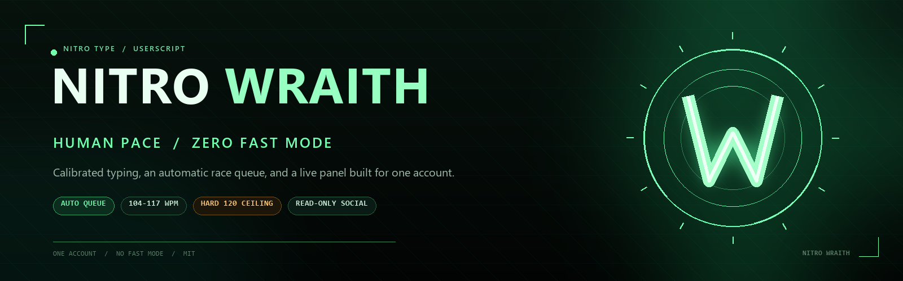
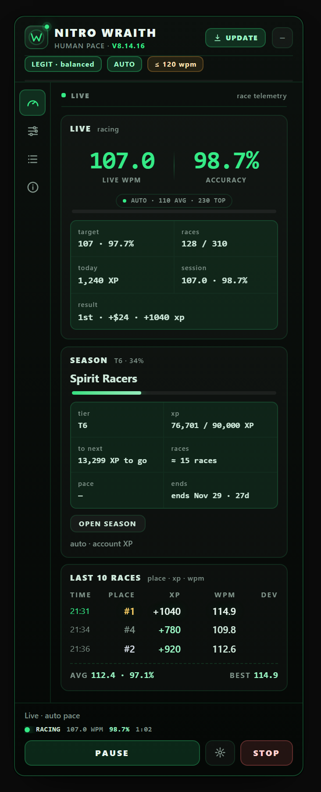
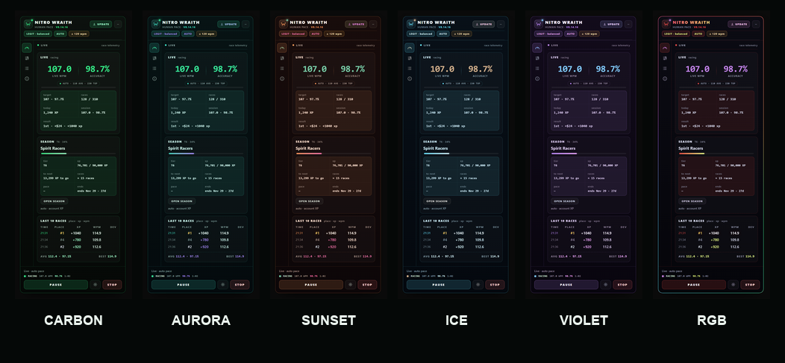

<div align="center">
  
</div>

<h1 align="center">NITRO WRAITH</h1>

<p align="center">
  <strong>Human pace. Zero fast mode.</strong><br>
  A Tampermonkey userscript for one Nitro Type account: an automatic race queue,
  typing calibrated to your own WPM average, and a live panel that shows exactly
  what is happening.
</p>

<p align="center">
  <a href="https://gist.githubusercontent.com/ezurinho/88f8b25546f8bb0ea588291bab8ffa58/raw/nitro-wraith.user.js">
    
  </a>
  <a href="https://github.com/ezurinho/nitro-wraith/releases/tag/v8.14.12">
    
  </a>
  <a href="CHANGELOG.md">
    
  </a>
</p>

<p align="center">
  <a href="CHANGELOG.md"></a>
  <a href="https://github.com/ezurinho/nitro-wraith/actions/workflows/check.yml"></a>
  <a href="LICENSE"></a>
  <a href="https://www.tampermonkey.net/"></a>
  
</p>

> **A userscript for one account, not a farm.** It chains races with human delays,
> keeps typing inside a calibrated range, and never pretends to be faster than the
> game allows.

<table>
  <tr>
    <td width="33%" valign="top">
      <h3>Human by design</h3>
      <p>Breaks, session limits, daily caps, and a hard ceiling of 120 WPM. No fast mode, no shortcut around the pace.</p>
    </td>
    <td width="33%" valign="top">
      <h3>Everything visible</h3>
      <p>Four views, six themes, a folded garage bar, and a live panel that stays readable while the race is running.</p>
    </td>
    <td width="33%" valign="top">
      <h3>Read-only social</h3>
      <p>Friends, online count, requests, and team are fetched with GET only. The script never accepts, denies, invites, or sends.</p>
    </td>
  </tr>
</table>

## The panel

<p align="center">
  
</p>

<p align="center"><sub>A real capture from the browser harness, with seeded demo values. The panel lives in the bottom-right corner of the game.</sub></p>

The panel is the control surface, not a black box:

- **Live view:** WPM, accuracy, the account-backed AUTO pace badge, target range, race count, session average, result, and the game HUD.
- **Garage queue:** what it is waiting for, the next race, Mystery Box timing, and a one-line reason for every hold.
- **TUNE:** pace profile, limits, breaks, stickers, sound, and the safety guard.
- **LOG / INFO:** history, season snapshot, diagnostics, and the keyboard map.
- **Header:** a small `UPDATE` button that only appears when the Gist has a newer version; it opens the fresh userscript. No button means the copy is current.

### Pace that looks like you

The first start reads the average and top WPM that the site already stores for
the account, then the stats API refreshes it every 30 minutes. Auto-calibration
is always on; there is no toggle that can freeze the pace at an old range. A 30
WPM account gets a 26–34 WPM range; a 43 WPM account gets 37–49. The target is
the average, not the top: the best WPM is shown as a reference, while every race
is drawn around the player's normal pace. Nothing starts at a generic 100+ WPM.
Clicking the `auto` row in TUNE only forces a fresh read; it never turns the
calibration off.

### Six themes

<p align="center">
  
</p>

<p align="center"><sub><strong>Carbon</strong>, <strong>Aurora</strong>, <strong>Sunset</strong>, <strong>Ice</strong>, <strong>Violet</strong> and <strong>RGB</strong>. All six keep the same layout; switch with <kbd>Alt</kbd> + <kbd>T</kbd> or the theme button.</sub></p>

## What it does

| Feature | What it does |
| --- | --- |
| **Race loop** | Chains races from the garage and results screen with human delays. Re-arms after a stop. |
| **Typing** | Reads your account average and top WPM, then races around that average (30 WPM stays near 30, 43 near 43) under a hard 120 WPM ceiling. Accuracy stays at the 96% reward floor or above. |
| **Rewards** | Claims the Mystery Box, closes daily challenges, and uses stickers when the settings allow it. |
| **Session care** | Renews the session when needed. Never types a username or password, and never solves a CAPTCHA. |
| **Limits** | Session races, time, XP, active hours, and daily race/XP budgets. |
| **Social** | Read-only Friends/Team counters. No write actions, ever. |

## Install

1. Install [Tampermonkey](https://www.tampermonkey.net/).
2. Open the [install link](https://gist.githubusercontent.com/ezurinho/88f8b25546f8bb0ea588291bab8ffa58/raw/nitro-wraith.user.js) and confirm.
3. Sign in at [nitrotype.com](https://www.nitrotype.com/).
4. Reload. The panel appears in the bottom-right corner.

> [!IMPORTANT]
> Install **one** file only. NITRO WRAITH replaces the old "Auto Redirect Script"
> and "Auto Stickers"; keeping another copy loaded will fight over the queue.

Manual install: create a new Tampermonkey script and paste
[`nitro-wraith.user.js`](nitro-wraith.user.js).

## Controls

| Shortcut | Action |
| --- | --- |
| <kbd>Alt</kbd> + <kbd>A</kbd> | Resume, including mid-race |
| <kbd>Alt</kbd> + <kbd>N</kbd> | Stop |
| <kbd>Esc</kbd> / <kbd>Alt</kbd> + <kbd>S</kbd> | Stop after the current race |
| <kbd>Alt</kbd> + <kbd>T</kbd> | Cycle the panel theme |
| <kbd>Alt</kbd> + <kbd>G</kbd> | Fold the garage panel |
| <kbd>Alt</kbd> + <kbd>M</kbd> | Mini-HUD: full, compact, or hidden |
| <kbd>Alt</kbd> + <kbd>R</kbd> | Clear the panel history |
| <kbd>Alt</kbd> + <kbd>H</kbd> | Print closed sessions to the console |

In the garage, **Resume** does the same as <kbd>Alt</kbd> + <kbd>A</kbd>. With a
live race it forwards the key; otherwise it clears the hold and re-arms the queue.

## Safety

> [!WARNING]
> Nitro Type prohibits bots and its anti-cheat can ban an account. NITRO WRAITH
> tries to keep the stats believable, but it cannot make automation invisible.
> This is your account and your risk. Never share cookies, tokens, or credentials.

The script never types credentials and never attempts a CAPTCHA. Those two remain
manual by design.

## Under the hood

<details>
  <summary><strong>What gets automated, and what stays manual</strong></summary>

  <br>

  - The queue, the race loop, the typing plan, the Mystery Box, stickers, daily challenges, and session renewal are automated.
  - Username, password, CAPTCHA, and account changes are manual.
  - The panel reads the game's own persisted state where possible; it does not invent XP or race results.
  - The social panel is GET-only and never posts, accepts, denies, invites, applies, or sends.
  - The guard stops the race on impossible WPM readings and warns when two copies are publishing at the same time.
  - The periodic panel paint runs at 1 Hz during a race and drops to one paint every two seconds while the bot is waiting; hidden tabs skip all DOM work. Unchanged calibration/update text is cached, and read-only social GETs are kept for two minutes.

</details>

<details>
  <summary><strong>Why the queue is deliberately boring</strong></summary>

  <br>

  A fast queue is easy to detect and easy to get wrong. NITRO WRAITH keeps a
  visible reason for every wait: a break, a session limit, an active-hours gate, a
  DQ block, or a missing race frame. The goal is a race loop that can run for a
  long time without leaving the account stuck on a results screen or typing into a
  dead race.

</details>

## Releases

Releases are automatic. When the `check` workflow passes on `main` and
`nitro-wraith.user.js` changed, the release workflow bumps the patch version,
updates the Gist, tags the commit, and creates the GitHub release. It needs a
repository secret named `GIST_TOKEN` with Gist write access; releases use the
built-in `GITHUB_TOKEN`.

- [Changelog](CHANGELOG.md)
- [All releases](https://github.com/ezurinho/nitro-wraith/releases)
- [Gist](https://gist.github.com/ezurinho/88f8b25546f8bb0ea588291bab8ffa58)

## Development

The script has no runtime dependencies. The harness needs Node 22+ and Chrome.

```bash
npm run live:test   # CLI checks without opening Chrome
npm run check       # syntax, Node checks, and the browser harness
npm test            # browser harness only
```

The main config lives in `CONFIG` at the top of `nitro-wraith.user.js`. Daily
settings live in `TUNE` and are stored in `localStorage`.

## Docs

- [`docs/NITROTYPE.md`](docs/NITROTYPE.md): game research, limits, and design notes.
- [`tests/live/`](tests/live/): browser harness, live mode, and fixtures.
- [`CHANGELOG.md`](CHANGELOG.md): what changed in each version.

## License

MIT. See [`LICENSE`](LICENSE).

<p align="center"><sub>NITRO WRAITH · human pace, zero fast mode · one account</sub></p>
