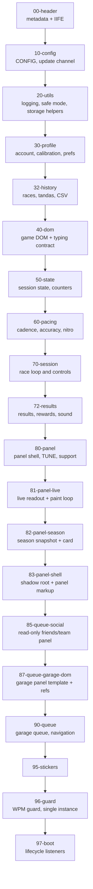
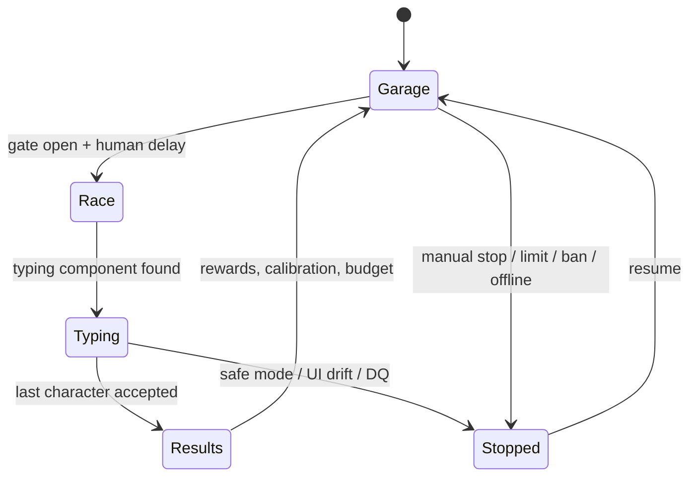
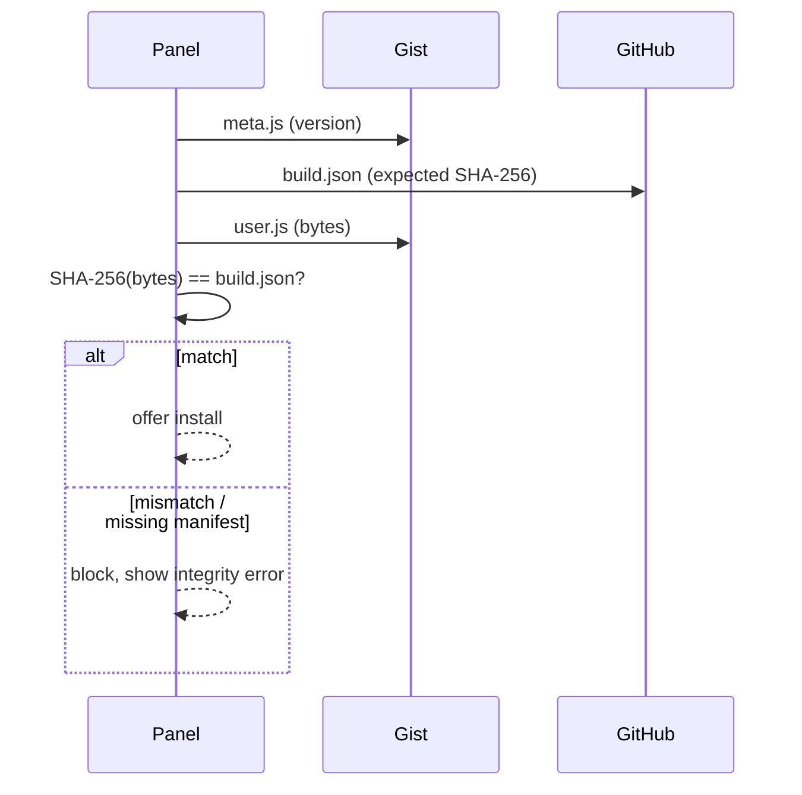

# Architecture

`nitro-wraith.user.js` is one generated IIFE. The source is split into ordered
fragments under `src/`; they share one lexical scope, so there are no imports and
the order in `tools/build.js` is the dependency graph.

## Modules

The concatenation is byte-checked by `npm run build:check`; the harness also
rebuilds the modules in memory and compares the full artifact, so a stale
generated file cannot reach a release.

## Race loop

`typingContract()` is the boundary with the game: if the typing component
disappears while a race is live, the loop stops instead of pressing keys blind.
`superviseLive` re-checks it periodically and records `ui-drift`.

## Update trust boundary

The version notice and the artifact are served by different hosts. The hash in
`build.json` binds them: a modified Gist, a stale CDN copy or a truncated asset
does not match and is not offered. The verification runs only when a newer
version exists, so the normal 5-minute check stays cheap.

## Storage

State lives in `localStorage` under `autoTyper*` and `ntQueue:*` keys. Reads and
writes go through `disk`, which catches blocked storage and quota errors. The
panel and the garage queue are different windows, so settings that must travel
between them use the `storage` event (theme, AFK, pause) instead of polling.

## Tests

- `tests/live/live.test.js`: static checks over the source, workflows, manifests
  and docs (no browser).
- `tests/live/run.js`: Chrome harness, seeded fixtures, real DOM and shadow DOM.
- `tests/visual`: 15 screenshots compared pixel by pixel on Windows.
- `tools/repro.js`: clean rebuild in two environments, compared by SHA-256.
- `tools/score.js`: reproducible static hygiene score (duplicates, risky
  patterns, same-origin message coverage, tests, docs and artifact size). It is
  printed at the end of `npm run check`; it does not replace the harness or a
  real race.
